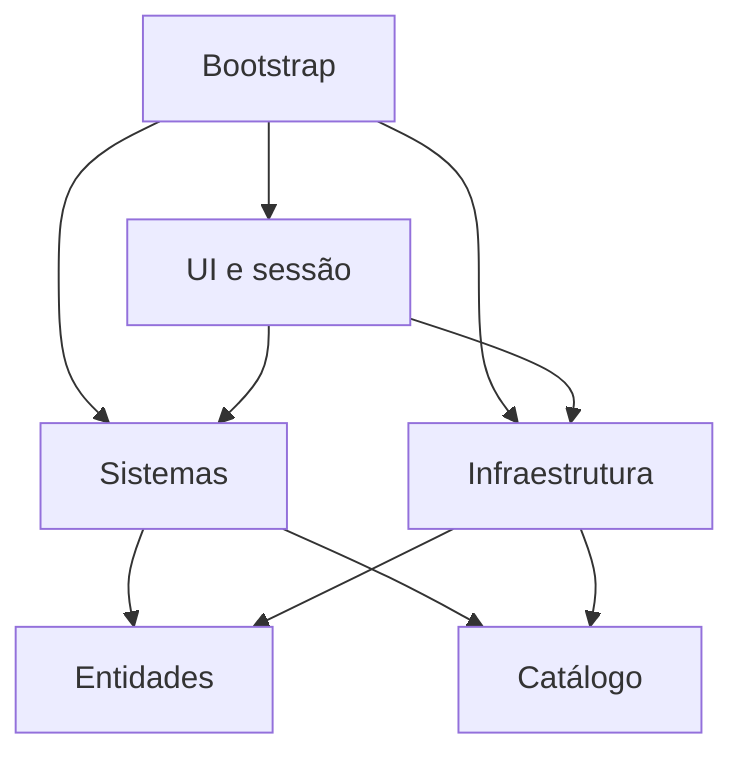

# Arquitetura

O domínio é formado por entidades Python simples. As regras de jogo vivem nos
sistemas e recebem explicitamente o catálogo da campanha. Interface e persistência
ficam nas bordas. Não há singleton, registrador global ou importação de JSON pelas
entidades. Duas partidas podem usar a mesma campanha sem compartilhar estado.

## Dependências

Setas representam importações, não fluxo de dados.

`entities` e `core` usam apenas a biblioteca padrão. `systems` importa essas duas
camadas e outros sistemas. `infrastructure` traduz arquivos em objetos internos.
`ui` apresenta o estado e encaminha comandos; `Session` é um adaptador que também
executa salvar/carregar. O bootstrap conecta todas as partes.

A dependência de `Session` no repositório JSON é deliberada: ambos ficam na borda.
Não é necessário criar interfaces abstratas para um único formato de persistência.
Se surgir um segundo armazenamento, injete um contrato de save/load em `Session`.
O núcleo já pode ser testado sem arquivos, terminal ou asciimatics.

O teste `test_dependency_direction` fiscaliza as dependências das três camadas
internas, incluindo a ausência de bibliotecas externas.

## Definição versus estado

| Definição da campanha | Estado de uma partida |
| --- | --- |
| HP inicial, dano, sprite e loot de um inimigo | HP atual e recompensa já concedida |
| Descrição e loot inicial da sala | Sala inspecionada e objetos no chão |
| Dano e bloqueio de uma arma | Armas possuídas e slot ativo |
| Parâmetros de cura | Cura equipada e cooldown atual |
| Mapa e objetivo | Posição, salas visitadas e vitória |

`Content` envolve os dados validados e seu hash. O campo `data` é um dicionário;
seu uso como catálogo somente de leitura é uma convenção do núcleo, não uma
estrutura profundamente imutável. Não altere esse dicionário durante uma partida.
Para modificar a campanha, edite o JSON e inicie outra partida.

## Fluxo de uma ação

1. A UI recebe uma linha completa; ociosidade e eventos não textuais não enviam ações.
2. `Session` trata consultas e operações de sessão. Ações de jogo chegam a `Game.command`.
3. `Game` verifica vitória, derrota e combate antes de despachar a ação.
4. `BattleController` valida a ação e executa no máximo uma resposta inimiga.
5. `Game` aplica loot e XP uma vez, seleciona o próximo inimigo da sala e atualiza o estado.
6. Os presenters leem o estado sem consumi-lo e produzem texto para a UI.

`Game.command(texto)` é a API pública recomendada para ações. Os métodos auxiliares
de `Game` presumem as condições verificadas por esse dispatcher. Não os invoque
diretamente em uma nova UI sem repetir essas condições.

## Por que a estrutura mudou

O `core/state.py` anterior importava entidades e sistemas, enquanto `Player`
importava movimento de `systems`. Isso contrariava o próprio sentido de
dependências planejado nas notas. `GameState` agora pertence às entidades; a
orquestração e o movimento ficam em sistemas. O bootstrap cria a partida.

Os registries globais foram substituídos por um catálogo injetado. O antigo
`BattleView` inspirou a separação de apresentação; os novos presenters projetam
texto sem drenar mensagens nem acessar dados globais. A lógica de loot saiu da UI.

## Próximas extensões

- **Nova UI:** adapte comandos e apresentação sobre `Game`/`Session`; não copie combate.
- **Novos inimigos/armas/salas:** edite definições JSON usando comportamentos existentes.
- **IA diferente:** acrescente uma política de ação inimiga ao combate; o motor atual sempre ataca.
- **Missões:** extraia o objetivo único para um sistema de condições/recompensas quando houver múltiplas missões concretas.
- **Outro armazenamento:** injete um adaptador em `Session`, mantendo as entidades livres de I/O.
- **Mais campanhas:** carregue arquivos diferentes com `--data`, mantendo IDs estáveis dentro de cada campanha.

O desenho segue a regra de dependências da Clean Architecture de forma enxuta.
Não pretende implementar todos os círculos, padrões ou interfaces possíveis.
